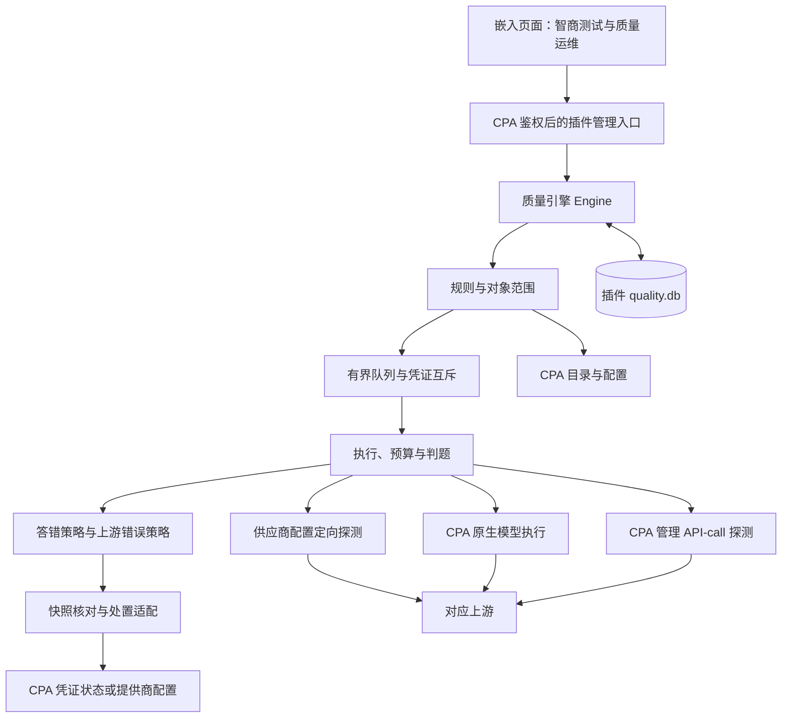

# 质量运维架构、实现现状与修复边界

0.32.0 的目标分页、准入并发复查、命令收据和展示投影见[服务与状态说明](SERVICE_LIFECYCLE_0_32_CN.md)。

2026-11-21 的后台恢复更新对应插件 `0.31.0`、UI `13.8.0` 和内嵌 Go/Sobek `2.2.1`。第 5、7 节记录当前的调度和管理授权实现。文中 0.30.11 的历史对照以当时本机部署的 0.30.10 构建源为基线。

本文记录当前源码实现、回归定位与公开接口限制。产品规则、用户决策及场景验收见 [质量运维逻辑说明](QUALITY_OPERATIONS_LOGIC_CN.md)。近期构建、集成和本地部署结果见 [版本记录](CHANGELOG_CN.md)。此前交付见 [0.30.2 三轮审查](COMMERCIAL_AUDIT_0_30_2_CN.md)、 [0.30.1 审查](COMMERCIAL_AUDIT_0_30_1_CN.md) 和 [0.30.0 记录](QUALITY_OPERATIONS_0_30_0_CN.md)。

## 1. 系统边界

CPA 负责凭证、提供商配置、模型目录、业务路由与实际启停。插件负责规则、检测任务、答题结果、凭证错误分类、普通处置记录和授权范围内的管理接口调用。

质量运维没有接管 CPA 的业务路由。通过管理接口停用对象后，正常业务调用是否被路由到它，由 CPA 当前配置和运行时决定。插件不应以历史普通停用记录额外维持一层永久业务禁用。上游错误停用期间，所有规则的答题与自动恢复均退出；用户在 CPA 启用后，下一轮按当前范围重新选择。

官方宿主公开回调不提供历史独立质量暂停及其归属释放能力。普通 `disable_credential` 与历史 `pause_credential` 是不同机制。保留历史归属与保护，不用普通停用模拟独立暂停，不修改官方 CPA 源码。

## 2. 实现模块

下表路径相对于仓库根目录，函数名用于定位，避免行号随工作区修改失效。

| 模块 | 主要职责 | 关键入口或类型 |
| --- | --- | --- |
| `plugin/cmd/model-quality/main.go`、`lifecycle.go` | 原生 ABI、管理路由注册、资源服务、用量回调、实例租约与关闭 | `engineRuntime`、管理与 usage 回调 |
| `plugin/quality/api.go`、`routes.go` | 鉴权后的插件接口分派、严格请求解析、分页响应 | `Handle`、`ManagementRoutes` |
| `types.go`、`engine.go` | 领域结构、能力、配置、实例状态、加载与重启 | `Engine`、`Rule`、`Run`、`Frozen`、`Target` |
| `rules.go`、`rule_schedule.go` | 规则增删改、版本、启停、Cron、单规则定时授权、结果决策入口 | `saveRuleLocked`、`setRuleTimer`、`decideLocked` |
| `rule_objects.go` | 对象分类、组授权、旧规则范围迁移 | `selectRuleObjects`、`validateRuleGroups`、`providerRuleProblem` |
| `scope_plan.go`、`scope.go`、`scope_skip.go` | 目录读取、候选范围、快照、准入、批次、未执行原因 | `collectScopeLocked`、`scopeAdmissionLocked`、`dispatchWithInventory` |
| `admission.go` | 手动测试校验、身份冻结、提交回执、持久入队 | 手动 `Submit` 路径 |
| `scheduler.go` | Cron 扫描、队列调度、worker、依赖互斥、usage 入队 | `Tick`、`claimRunLocked`、`worker` |
| `execution.go`、`questions.go`、`collector.go` | 样本执行、取消、响应完整性、题目冻结、判题 | `execute`、`DeterministicJudge`、响应 collector |
| `host.go` | 官方 SDK 目录与原生执行适配 | `NativeHost`、`Targets`、`Execute` |
| `management_client.go` | 进程内管理授权、文件凭证快照、API-call、状态与删除接口 | `CredentialSnapshot`、`executeManaged`、`SetCredentialDisabled` |
| `provider_directory.go`、`provider_targets.go` | 配置与运行时关联、路由身份、模型映射、停用组目录补全 | `providerDirectory`、`providerRoute`、`configuredTarget` |
| `provider_probe.go` | 使用当前配置构造定向请求、协议解析、机密过滤 | `executeProvider`、`probeRequest` |
| `credential_policy.go` | 普通处置归属、答错及错误动作、恢复、人工核对 | `CredentialDisposition`、`decideManagedLocked`、`admitSnapshotLocked` |
| `provider_disposition.go`、`provider_mutation.go` | 整组完整性、组归属、配置条件写入与确认 | `providerRoundVerdict`、`providerWriteSnapshots`、`setProviderDisabled` |
| `upstream_error.go`、`catalog_action.go`、`error_policy_disabled.go` | 上游错误分类、目录缺项动作、当前状态同步与有效错误来源排除 | `managedUpstreamCondition`、`reconcileCurrentTargetsLocked`、`observeMissingEntriesLocked`、`errorPolicyDisabled` |
| `transitions.go`、`snapshots.go` | 执行复查、取消、原子提交本地状态、快照 | `checkExecution`、`commitLocked` |
| `store.go`、`budget.go` | bbolt、迁移、调用和 token 预算 | `Store`、`reserve`、`account` |
| `queries.go`、`metrics.go`、`result_limit.go`、`removed_credentials.go` | 历史投影、统计、保留和清理、已移除凭证核对 | `queryRules`、`metrics`、`clearRuleHistory`、`checkFinishedRounds` |
| `reconcile.go` | 历史独立暂停对账、保留与存储准入 | `Reconcile`；官方不具备独立暂停时不会执行该对账 |
| `plugin/ui/app.js`、`view.js`、`client.js`、`index.html` | 编辑、范围选择、刷新、结果展示、浏览器管理请求 | `editRule`、`loadOperations`、`providerRouteReady` |

## 3. 管理通道与调用路径

### 3.1 两种管理路径

插件业务接口注册在官方已经鉴权的 `/v0/management/plugins/model-quality/` 扩展通道。SDK 模块名中的 `/v8` 不决定插件扩展 URL。

插件调用 CPA 原有管理接口时使用 `/v8/management/...`。静态页面由资源通道服务，不在公共资源 GET 中执行业务变更。

| 插件接口组 | 功能 |
| --- | --- |
| `/targets`、`/questions`、`/presets` | 对象、题目与预设 |
| `/runs`、`/runs/detail`、`/runs/cancel`、`/runs/review` | 手动提交、查询、取消、人工评审 |
| `/rules`、`/rules/run`、`/rules/pause` | 规则配置、立即执行、规则启停 |
| `/rules/timer`、`/rules/scheduling` | 单规则定时与兼容的全局调度控制 |
| `/rules/question-preview`、`/rules/scope-preview` | 题面和范围预览，不发起模型请求 |
| `/rules/handling/acknowledge` | 未确认处置的人工核对；不写 CPA，也不改规则启停。普通已确认停用通过正常状态读取自动同步 |
| `/runs/history`、`/rules/run-history`、`/history`、`/metrics` | 手动与规则历史清理、审计和统计 |
| `/actions/preview`、`/actions/release` | 历史独立暂停接口，受宿主能力限制 |

完整方法与路径以 `ManagementRoutes` 为准；上表没有增加新接口。

`GET /rules` 附带独立于规则分页的 `orphaned_handling` 安全摘要，展示已删除规则留下的 `attention`。原核对入口仅在 `rule_id` 为空、原规则确已不存在且 `auth_id/action_id` 精确匹配时允许孤立记录核对；复用当前启用/删除与整组完整性检查，不返回凭证快照、不新增 CPA 写入。

### 3.2 三条模型请求路径

| 路径 | 主要使用场景 | 证据及限制 |
| --- | --- | --- |
| 原生 `host.model.execute` / `execute_stream` | 手动智商测试、通常的纯观察规则、未授权整组写入的供应商观察 | 由 CPA 处理原生路由与协议转换；官方回调没有历史独立暂停要求的可信最终 payload 证明 |
| `/v8/management/requests/api-call` | 受支持的 OpenAI / Codex 文件凭证管理探测及停用中复检 | 精确绑定 `auth_index`，认证头使用 `$TOKEN$` 占位符。题面与模型名包含相同字面文本时，发送给上游后仍保持原文。证据路径为 `cpa_management_probe` |
| 提供商配置定向 HTTP 请求 | 授权处置、停用配置组检测和恢复 | 核实配置与映射，密钥只用于后端请求；证据路径 `provider_config_probe` |

原生调用成功不保证相同参数的定向探测可执行。当前部分 Claude、Gemini、Interactions、Vertex 提供商的显式思考强度需要 CPA 原生转换，定向探测会报告不支持。配置缺少可核实的 URL、模型映射、身份或安全请求头时，也可能无法探测。

提供商原生与定向输出均需避免泄露读取到的敏感配置。配置探测会检查返回模型与上游映射的一致性。文件凭证探测先用 `managementProbeResponse` 校验 CPA 的管理回执，再将上游状态与响应交给 `managedUpstreamCondition` 分类。错误正文与响应头仅在本轮内存中参与分类。管理探测证据不会被伪装为 CPA 业务最终 payload 的可信证明。

0.30.3 的 `provider_reasoning.go` 为手动页面投影经过核实的路由思考配置，`management_client.go` 补充精确静态模型目录能力。显式配置优先，保留预算及特殊档位；模型键缺失、明确 null、空对象分别表示未知、无思考支持、没有声明档位或预算限制。自定义兼容通道聚合了多个路由的公开别名，不能用它推断单路由能力。此元数据仅服务展示与请求选择，参数转换及最终 payload 仍由 CPA 执行，原有定向探测协议限制不变。

### 3.3 普通启停接口

文件凭证状态通过 `PATCH /v8/management/credentials/status` 修改，删除通过带文件名的凭证删除接口完成。文件凭证不支持原子条件状态写入或条件删除；写前、写后核对不能消除最后检查与实际写入之间的并发窗口。

供应商按能力使用单路由 `excluded-models` 通配项或 OpenAI 兼容配置组的 `disabled`。恢复时保留原模型排除内容。配置写入使用官方提供的强 ETag 与 `If-Match`，冲突不盲目重试。写后还要核实配置与运行时一致。

供应商配置删除当前不受支持。明确整组授权与完整组检测条件不能由“选择全部对象”隐式替代。

## 4. 数据模型与权威来源

| 数据 | 表达的事实 | 权威来源 |
| --- | --- | --- |
| `Target` | 本次读取的对象身份、启停、目录、运行状态与能力 | CPA 目录、配置及插件的只读投影 |
| `Rule` | 对象类型、范围、检测计划、两类策略、恢复及调度授权 | 插件持久配置 |
| `Frozen` | 本轮规则版本、题面、参数、身份、模型、样本、快照 | 派发时冻结，执行时复查 |
| `Run` / `Sample` | 执行状态、回答、质量判定、错误证据、处置结果 | 本轮实际执行 |
| `CredentialDisposition` | 普通操作意图、结果、规则归属和当时快照 | 插件本地记录与 CPA 写后确认 |
| 历史 `Action` | 独立质量暂停归属 | 历史宿主机制和保留记录，不能与普通停用互换 |
| 审计与回执 | 发生过的操作、提交去重关联 | 插件持久记录 |

`ManualDisabled` 是现有字段名，主要投影 CPA 的 disabled 状态。仅凭该字段为真，不能认定最后一次停用一定由管理员执行。普通处置归属来自独立记录。

启用、有效可用、是否存在历史错误、是否允许本规则恢复是不同维度。`RuntimeStatus=registered` 是供应商可能的合法状态，不能在一个入口被视为可用、另一个入口又只因状态名不同而拒绝。

本地数据库 `quality.db` 使用 bbolt，目录权限 `0700`、文件权限 `0600`，单实例打开。桶包括 `meta`、`runs`、`rules`、`audit`、`usage`、`idempotency`、`presets`。普通处置记录与定时授权保存在 `meta`，不是 CPA 独立 owner。

`commitLocked` 先在一个 bbolt 事务中提交相关本地状态，再更新引擎内存。CPA 写入与插件数据库不在同一事务中。

`CredentialDisposition` 增加独立的 `AnswerOwnerRuleID` 与 `ErrorSource`，分别记录原答错恢复归属及新的上游错误来源。历史 `Snapshot` 留作追溯；每轮 `Frozen.ManagedProbe` 保存当前执行与写前条件。未知写入继续使用原意图和状态隔离。仍沿用现有数据库与事务结构，不引入新的存储系统。

## 5. 调度、执行与持久化顺序

1. 新建或修改规则校验类型、范围、计划、策略和权限，更新 revision。预览不调用模型。
2. 后端每秒检查定时计划。五段 Cron 使用服务端时区；旧间隔及时区配置保留兼容处理。
3. 定时需要规则自身可运行、`SchedulingEnabled` 有效，以及旧全局开关或该规则单独定时授权。显式关闭全局调度会撤销单独授权。
4. 后台读取持久化的 `NextRun`。停机错过一个或多个周期时，用当前版本和当前目录合并补一轮，并按原 Cron 计算下一次时间。依赖的管理授权或目录未就绪时保留到期时间，读取 `timer_wait_reason` 可查看等待原因。已有合法排队或运行中的同规则轮次覆盖本次到期。
5. 动态读取目录，在范围与恢复判断前同步当前 CPA 启用状态。确认外部启用时结束旧普通阻断、取消旧任务、重置相关旧计数；按本次对象类型和范围展开。同一次到期扫描可共享目录读取；新对象在下一次匹配轮次加入，不追加到已冻结批次。
6. 在一个 bbolt 事务中保存下一次定时时间、批次与各对象的新冻结计划，再进入有界队列。中断前已经受理的任务按原回执中断。新进程依据已提交的时间及回执识别已处理周期。补检受理时追加 `rule_timer_catchup` 审计。
7. worker 一次性预留主体、判题和对照的全部凭证依赖。冲突任务继续排队，不占用 worker 等待凭证锁。
8. 执行前及每份样本前复查规则版本、取消、身份和限制。先持久记录预算预留，再发送请求。
9. 解析完整性、质量判定与上游错误。完整轮次结束，或符合错误处置条件提前结束时，进入规则决策。
10. 写入前再次检查当前规则、快照、证据与整组授权。先持久保存操作意图，再调用 CPA，最后保存确认结果或待核对状态。

同一动态规则涵盖多种调用路径时，目录中可独立核实的启用 OAuth 文件可先走公开 SDK。处置规则仍须核实自身所需的管理能力和当轮快照。0.32.1 源码将提供商目录覆盖、等待重新授权的条目和已经受理的对象分别记录在本次到期记录中，与新任务一起提交。单独的提供商目录故障允许已满足所有准入条件的文件继续。某个主体、对照或判题凭证正在重新授权时，对应对象留待协调收据及当前身份核实。等待解除后按当前规则重新取证，只补同一到期记录中仍待执行的对象。暂停、修改和撤销定时许可按现行修订生效。SDK 目录暂时不可读会触发有限退避，已受理的模型调用不进入该重试流程。[调度实现](../plugin/quality/partial_schedule.go)

质量配置的宿主输入仅包含 `quality.Config`。旧版本只有 `config_input` 摘要，升级首次读取已有面板设置并记录 `quality_host_input`。此后逐字段合并真正发生变化的宿主质量设置。`explicit_rule_timers` 单独保存，后台密钥及连接配置独立存储。更换连接和修改保留天数等无关参数均保留原有逐规则许可及其他面板设置。

已建立的原生流可关闭。官方非流式回调及流建立之前的调用不提供同等的立即取消保证。取消后晚到的结果不得成为新的处置依据。

撤销定时许可与取消旧排队、运行任务在同一事务提交；提交成功后取消活动上下文并推进内存调度代次。目录扫描和已捕获到期周期在落队列前复查该代次，关闭再开启不会复活旧任务。手动测试与“立即执行”不使用这项定时许可。手动提交在最终快照读取后、持久入队前再次检查请求取消。

单规则的 `scheduling_enabled` 是保存的配置，`timer_active` 是同时满足规则状态与实例/单规则授权后计算出的实际状态。停止接口按保存的许可判断是否需要更新，不能仅凭当前不活跃就返回成功；前端开关修改保存的许可，状态标签和下次执行反映实际状态。

写前本地条件失败使用明确的 `errCredentialPrecondition`，表示尚未发送状态或删除请求，可保留原归属并等待新的完整轮。请求已发送且结果无法确认仍进入待核对，不自动重放。人工核对要求当前启用快照或精确删除证据；供应商组必须核实当前完整成员，目录暂时遗漏不能解除保护。

当前队列满时，动态派发可以返回带 `queue_full` 未执行项的批次回执，并不总是使整个 API 请求报错。文档和界面应区分“收到派发请求”与“已经开始模型调用”。

## 6. 默认值与统计口径

以下为当前源码默认值，不代表建议修改：

| 项目 | 当前值 |
| --- | --- |
| 新规则对象与范围 | OAuth 账户、仅已启用 |
| 题目与模型 | `logic-candy`、`gpt-6.2-sol` |
| 思考强度与样本 | `high`、每模型 1 份 |
| 答错动作 | 仅检测 |
| 上游错误动作 | UI 在支持处置时四项预选停用；API 新建省略字段时不自动补入这些动作 |
| 自动恢复、定时 | 默认关闭 |
| Cron | `*/30 * * * *` |
| worker、队列入口 | 2、32 |
| 模型与样本 | 默认最多 8 个模型。每模型样本数默认为 1，手动与规则任务均可指定更多份。 |
| 输出与响应限制 | 配置最大输出 4096 token、响应默认 262144 字节；单次请求实际输出限额见冻结参数 |
| 每日预算 | 默认 1,000,000 token，按 UTC 日期记账。手动、立即执行、定时、补检与恢复复检使用同一套记账；主体、对照及独立判题的调用次数仅用于统计。 |
| 历史与存储 | 通用保留 30 天、存储准入阈值 128 MiB；新规则另默认每对象保留 100 条结果 |

答错仅检测与上游错误预选停用属于独立策略组合，不构成逻辑冲突。UI 与直接 API 的创建默认值不同，应明确展示来源，不因文档任务擅自改动。

自动答错处置使用完整轮次，不沿用历史独立暂停的默认三轮失败阈值。历史 `FailThreshold` 仍存在，不能据此推断普通停用等待三轮。

质量统计采用已存储 `QualityVerdict`，不会因为手动展示字段 `AnswerMatch` 或人工 `Review` 显示正确就自动改写。通过率分母是明确正确与错误样本，覆盖率另统计已判定的计划位置。预检、跳过与已清理历史不混入有效答题统计。

官方 usage 回调缺少完整来源归因，入口当前写入 `unknown`。这些执行尝试统计不能被当作已精确区分的用户业务请求数。

## 7. 重启、认证和历史清理

后台管理授权经 CPA 验证后保存在插件的专用数据卷。每个插件实例维护一个回环客户端和一个异步恢复任务。普通账号、质量和连接状态 GET 只读。浏览器退出与 CPA 是否可以在后台执行分别判定。各功能依赖和状态码见[后台连接和恢复](BACKGROUND_CONNECTION_CN.md)。

普通供应商探测密钥不进入检测历史。账号登录模块的账号资料存储属于另一套功能，不在本次质量运维状态修复中改变。

启动会将旧 `queued/running` 任务记为 `interrupted`，不自动重发调用。未完成的普通写入进入待核对，不因重启重放。存储故障会阻止新的任务及处置，避免发生无持久记录的写入。

规则按每个对象分别保留最近完成的主测样本，无样本的诊断运行占一条。后台使用本轮完整证据完成判定及处置收据，再按配置裁剪。窗口可以小于一轮。未确认处置、有效上游错误来源与历史独立暂停仍可保留完整证据。同一模型、样本序号对应的主测与对照记录配对裁剪，已完成对照但未到达的主测位置仍可查看其对照回答。[裁剪实现](../plugin/quality/result_limit.go) · [终态与收据](../plugin/quality/execution.go)

当前“清空规则运行记录”作用于所有规则的可清理历史，即使页面正在筛选单条规则，也不是只清理筛选结果。它不改变 CPA 状态、规则定时和手动测试历史。

删除规则清理规则及可清理历史，不向 CPA 发起启用。仍有效的上游错误停用来源及必要触发记录继续保留，不能通过删除原归属规则或错误触发规则绕过退出检测。没有错误来源的已确认普通答错关联沿用原删除清理语义。进行中写入阻止删除，未知结果保留隔离和必要证据。历史独立暂停有自己的删除限制。

## 8. 审查差异的当前处理结果

下表保留原审查编号，区分已实现修复、沿用行为和仍有的公开接口限制。回归名称表示具体覆盖范围，实际命令、平台与结果以交付记录为准。

| 编号 | 当前实现 | 关键定位与回归 |
| --- | --- | --- |
| C01 | 前后端对合法供应商 `registered`、`active` 使用一致条件；旧错误记录不单独否决当前启用对象 | `view.js` 的 `targetRuntimeReady`、`credentialBlock`；`TestManualRegisteredProviderWithPersistedErrorSuspension`、`verify_manual_provider_selection.cjs` |
| C02 | 目录不再因本地错误记录隐藏对象；在范围筛选前读取当前状态并同步确认过的普通记录 | `inventoryContextLocked`、`reconcileCurrentTargetsLocked`、`collectScopeLocked`；`TestErrorPolicySuspensionsSkipEveryScope` |
| C03 | 目录展示、手动提交、规则派发和执行复查均接入当前状态同步 | `visibleTargets`、`submit`、`dispatchWithInventory`、`checkExecution`；`current_state_test.go` |
| C04 | 普通停用只取消受影响任务，保留规则启用和定时设置；其他对象继续执行 | `cancelManagedRuns`、`decideManagedLocked`、`decideProviderLocked`；`TestManagedDeleteStopsDependentsAndDoesNotRecreate`、`TestExternalEnableCancelsStaleRecoveryWithoutChangingRulePermissions` |
| C05 | 未确认处置核对保留规则设置；普通已确认停用无需按钮核对 | `acknowledgeHandling`、`acknowledgeProviderGroupLocked`；`verify_upstream_actions_ui.cjs` |
| C06 | 运维可见轮询同步 targets；手动入口恢复可见时刷新，提交前主动读取当前目录 | `app.js` 的 `loadTargets`、`loadOperations`、`submitRun`；`verify_operations_live.cjs`、`verify_run_receipts.cjs` |
| C07 | 旧的“外部启用后永久排除”断言已替换；当前启用进入新轮，旧任务和证据不重放 | `error_policy_disabled_test.go`、`TestExternalEnableCancelsStaleRecoveryWithoutChangingRulePermissions`、`smoke_error_suspensions.py` |
| C08 | 全部范围允许本规则恢复关闭时继续检测，也允许他规则答错停用对象只读检测；恢复仍由原规则授权 | `scopeAdmissionLocked`、`canInspectManualDisabled`、`recoveryDenied`；`credential_policy_test.go` |
| C09 | 保留已确认且非空目录缺项整对象处理，不测其余模型，也不绕过目录调用缺失模型 | `firstMissingModel`、`queueCatalogRun`、`catalog_action.go` |
| C10 | 保存验证只为答错自动处置要求标准答案；错误策略支持可探测的自定义、视觉及人工评审题 | `validateManagedRule`、`executeManaged`、`probeRequest`；`TestErrorOnlyQuestionsExecuteWithoutStandardAnswers`、`TestAnswerHandlingStillRequiresSupportedAutomaticJudgment` |
| C11 | B 的全部范围检测取得新错误时保存 `ErrorSource`，保留 A 的 `AnswerOwnerRuleID`，已停用不重复写 CPA，全部规则退出恢复 | `credential_entry_lifecycle_test.go`、`TestCrossRuleProviderErrorExcludesWholeGroupWithoutTakingRecoveryOwnership` |
| C12 | 长期条目比较与本轮完整快照比较分开；同定位条目的跨轮内容变化不清除答错归属 | `sameCredentialEntry`、`projectOwnedTarget`、`sameSnapshot`；`TestAnswerOwnershipUsesCurrentEntryContentEachRound`、`TestOwnedRecoveryRejectsMutationInsideRoundButKeepsOwnership` |
| C13 | 已核实 AuthID/auth_index 并非所有供应商编辑都稳定；没有猜测映射。当前实现保护无法关联的旧记录，不能承诺所有密钥轮换均自动延续恢复权 | 见 9.5；CPA `Auth.EnsureIndex`、`StableIDGenerator.Next` 与插件 `provider_directory.go` |
| C14 | 手动测试冻结当前账号/供应商快照，已启用后不要求旧账号摘要、邮箱或旧内容匹配；执行中内容变化仍阻止旧任务 | `currentManualAccountLocked`、`verifyEnabledManualFile`、`verifyManualSubjectLocked`；`TestManualReenabledEntryUsesCurrentAccount` |

## 9. 当前状态、权限与证据边界

### 9.1 正常读取同步普通记录

CPA 为当前启停的权威来源。`reconcileCurrentTargetsLocked` 对目录中的已启用对象读取当前快照，只处理原状态已确认的普通 `disabled` 记录。历史独立暂停、未知写入、身份冲突保留原保护。该操作不写 CPA、不发起模型测试、不建立额外启用审批。

确认当前启用后，普通记录转为 `externally_enabled`，保留原证据与审计；取消依赖旧处置的排队或进行中任务，清空相关规则的旧失败计数与证据签名，保留规则启用和定时设置。执行复查继续核实规则版本、取消、当前身份和本轮快照，晚到的旧结果不能再次处置。当前启用后的新轮次可以依据新明确证据应用策略。

读取失败用 `handling_state_reason` 或具体接口错误说明实际问题，不把旧记录投影为当前仍停用。`error_policy_block` 只投影当前仍停用且有效的错误来源。供应商整组启用在一次本地事务中同步：保留成员均须当前启用、身份一致、当前组成员和配置可核实；缺项、成员变化或部分停用不能只清掉一条路由后宣布整组解除。

前端的 `credentialBlock` 不将历史错误来源当作当前已启用对象的独立禁用条件。手动测试已经选择完整计划时，普通停用缓存允许“开始测试”进入当前状态读取；仍停用则没有模型任务 POST，当前启用则直接提交。管理会话切换使旧异步提交失效。正常刷新、提交或派发均可同步状态，不依赖后台轮询先完成。

### 9.2 候选、执行、恢复与写入分别判定

规则先按 `ObjectTypes` 和 `TargetScope` 选择候选，再核实当前协议/目录能否执行，之后分别判断恢复与写入资格。

- 仅已启用：普通检测选择当前启用对象；只有本规则答错停用且当前开启恢复的对象取得恢复例外。
- 全部对象：管理员停用、本规则答错停用但恢复关闭、他规则答错停用对象均可保持停用检测；身份或通道不可核实时记录具体原因。
- 指定对象：遵守已保存的凭证/路由/组绑定与类型，不因发现相似名称扩大范围。
- 错误停用：所有规则都退出后续答题及恢复；正常状态读取继续，直到 CPA 当前启用。

自动恢复仍要求答错动作为普通停用。当前全部范围可以授权没有其他归属的管理员停用对象恢复；已经有答错归属的对象只由原规则恢复。他规则只读检测不授予恢复、删除或接管归属权限。

固定路由经授权扩展到同组成员时，`subjectBindingProblem` 同时核对原绑定的提供方、已保存的索引及当前组。在成员采样前和 `providerWriteSnapshots` 写前复查时均使用这项判断。直接绑定配置组时，成员须仍在选定组内。固定的供应商对照或判题依赖遇到目录读取故障时，预览与派发都标记目录未核实，跳过记录仍归属于被测对象。

上游错误策略独立消费可信错误证据。自定义、视觉及人工评审题无需标准答案，但仍受实际协议和探测能力约束；答错自动处置要求支持的标准答案题及确定性判定。独立对照和 LLM judge 在管理探测中的限制继续保留。人工补充评审不能自动触发处置。

### 9.3 跨规则错误来源与完整组证据

`CredentialDisposition.AnswerOwnerRuleID` 保存原答错恢复归属；`ErrorSource` 保存触发规则及版本、运行、路由、模型、错误类别、证据和时间。历史顶层 `UpstreamCondition`、`CatalogMissingModel` 保留兼容读取。没有原答错记录的首次错误停用不创建答错恢复权。

A 答错停用后，B 的全部范围可检测；B 对新明确错误配置停用时，核实当前仍停用、原记录与本轮定位和内容一致，再在本地保存 B 来源。A 归属和原动作不变，CPA 停用写入为零。所有规则随后退出答题与恢复。B 仅记录错误不改变 A 资格。整组转换需要 B 的明确整组授权，所有组记录在同一持久转换中更新；未授权单路由不能触发组处置。

`providerRoundVerdict` 检查同一批次下各路由的模型、题目与样本计划。各组员的 `roundVerdict` 逐一核对计划位置、执行状态和证据。任一成员的运行或样本留有执行错误或上游错误条件时，即便样本保存了「正确」，整组也保持停用并保留原答错归属。答错停用要求整组都可判定且至少一份答错，恢复要求整组全部正确。写前再次读取成员与配置。新的明确上游错误仍可单独按策略提前处理已授权组。

`queryRules` 将原归属和错误来源投影到原归属规则的处置记录，界面显示 A 归属及 B 来源、触发模型与时间；B 的运行仍保留本轮错误。历史清理和删除任一相关规则不能清除仍有效的错误来源。删除后的源记录继续参与对象准入，不能依赖触发运行仍在普通历史中才识别原因。

供应商配置目录和 CPA 运行时目录分别校验。配置含重复 JSON 字段、成员或模型映射结构残缺时，该读取无法建立可用路由。路由 ID、索引或执行器冲突时保留原归属，受影响的对象退出检测。核实已停用整组时，SDK 须明确返回凭证清单和凭证模型清单，缺少数组无法证明运行时已无该组。组成员列表在一次目录读取内排序并共享；持久化快照拥有独立副本。

### 9.4 规则生命周期与旧配置

普通停用不再通过 `stopManagedRules` 永久停止其他依赖规则；只取消本轮受影响任务。外部启用、自动恢复与未知处置核对不启动管理员停止的规则，也不修改其定时选择。旧规则明确设置、旧范围迁移、供应商观察限制与整组授权仍保留。

没有对来源不明的历史停止进行批量恢复。仅有“当前停止”或旧停用记录不足以证明没有后续人工停止，因此本轮保留这些规则的原配置，用户可按当前需求明确启用。

队列持久化、提交回执、幂等键、规则版本、主体/对照/判题依赖互斥、预算、取消和执行复查继续有效。重启将旧未结束任务记为中断；未知写入进入隔离，不重发调用或管理写入。

### 9.5 条目连续性的实现与公开接口限制

用户确认的语义是跟随同一个 CPA 条目：token 刷新、同条目更换账号内容或密钥，不因完整内容摘要变化而丢失答错归属。当前代码把长期定位与本轮快照分开，适用于公开定位能够保持且唯一核实的情形；没有宣称所有供应商编辑都具备这样的稳定定位。

| 字段/检查 | 当前来源与用途 | 不能据此证明的事实 |
| --- | --- | --- |
| 文件 AuthID、auth_index、文件名、提供方 | CPA 文件定位；`Auth.EnsureIndex` 通常按类型与规范化文件路径派生索引，已设置索引可能沿用 | 同路径被删除后重建是否还是原条目 |
| 供应商 AuthID | CPA `internal/watcher/synthesizer/helpers.go` 的 `StableIDGenerator.Next` 按配置材料派生；提供方实现可包含密钥、URL、代理、前缀、请求头、池配置 | 换密钥后新 AuthID 必定与旧条目连续 |
| 供应商 auth_index | `sdk/cliproxy/auth/types.go` 的 `Auth.EnsureIndex` 可按提供方、URL、密钥及池设置派生；部分配置由管理端提供索引 | 所有配置编辑和删除重建都有永不变化的索引 |
| `ProviderGroupID` | 插件按类型、组名、base URL 派生，供当前组归属与授权核实 | 仅凭组名、地址、列表位置就可证明成员连续 |
| `sameCredentialEntry` | 比较 AuthID、auth_index、Name、Provider、ProviderMechanism、ProviderGroupID | 无操作事件时重建未观察到的条目生命周期 |
| `Fingerprint`、`UpdatedAt`、`FileModifiedAt`、成员集合、ETag | 本轮内容、状态与并发条件检查；历史快照供追溯 | 时间/摘要变化必定发生过人工启用 |

文件条目定位相同且可核实时，token、账号内容与轮次间时间变化不影响答错恢复归属。每轮从当前快照重新检测，在本轮写前核对全部内容。供应商定位保持不变的配置更新同样使用新轮次快照；组恢复还要求原授权模型计划和完整当前成员。

**仍存在能力缺口：供应商换密钥导致公开 AuthID/auth_index 改变时，没有可靠持久条目 ID 或编辑事件可区分同条目更新与删除重建。** 新增插件 UUID 不能解决如何唯一对应当前条目。当前没有按名称、列表位置或配置摘要猜测迁移的映射，也不能保证这种密钥轮换自动继承旧恢复权。旧记录保留，不能把旧归属施加到另一个当前已启用对象。

完整且已核实目录观察到旧定位消失后，`observeMissingEntriesLocked` 将已确认记录转为 `entry_missing`，保留记录/审计并取消旧任务。该记录不再给随后复用同名定位的对象恢复例外；目录失败或未核实供应商目录不能触发此转换。若删除重建完全发生在两次观察之间，且当前公开字段完全相同，官方接口无法可靠还原中间操作。此限制明确保留，不以 token、更新时间或高频轮询伪装成已经解决。

### 9.6 三类数据的生命周期

| 数据 | 负责什么 | 何时失效或结束 |
| --- | --- | --- |
| 答错恢复归属 | 原规则与可核实 CPA 条目之间的恢复权限 | 正常读取已启用后结束；完整目录已观察到条目消失后不再授予新条目；跨轮内容更新本身不清除 |
| 上游错误来源 | 追溯错误并使当前停用对象退出所有答题/恢复 | 正常读取 CPA 当前启用后结束阻断；删除规则或清历史不能绕过 |
| 本轮快照与证据 | 证明本轮实际请求及写入条件 | 本轮内容、身份、组成员、状态或规则版本变化即失效，下轮重新取得 |

未知写入仍独立保存意图与状态；不能借普通启用同步或稳定条目改造自动认定成功。没有条件状态/删除 API 的文件写入，仍有最后检查到实际写入的并发窗口；供应商 ETag 条件写入也不替代身份及完整组检查。

### 9.7 两次读取之间的启停

同条目答错停用，管理员在两次读取之间先启用再停用，而插件两次都只观察到停用时，归属不因内容或时间戳变化失效；按当前范围与原规则资格重新完成一轮。若正常读取确实观察到启用，旧普通来源与恢复归属结束，之后的人工停用按当前范围处理。

CPA 公开 auth 回调提供当前状态，没有足以重建每次启停的可靠操作序列。稳定定位解决关联，不能还原未观察到的操作历史。上游错误不会因此获得答错恢复权限，也不会成为当前已启用对象的永久阻断。

## 10. 源码回归与交付证据

`plugin/quality/background_recovery_test.go` 用临时数据库、假 CPA、假凭证和可控时钟复现了三项旧行为。管理接口未就绪时旧实现推进了到期时间，重启后原周期没有入队，修改宿主保留天数还会清除逐规则许可并把面板预算从 58 改回 200。

修复后，5 小时 3 分钟的中断合并为一条补检审计、一个批次、两个当前对象和四次假模型探测。部分批次重启时，已受理的文件任务记为中断，补检只排入当时的提供商和新加入的文件。用户在补检前暂停、停止定时、删除或修改规则时，旧周期无额外模型调用。停机期间才打开全局调度时，原本拥有逐规则许可的一条规则获得补检，原本缺少许可的另一条从下一个 Cron 开始。[调度竞态回归](../artifacts/backend-connection-0.31.0/scheduler-recovery-race.log)

在已经确认答错停用的假凭证上更换管理密钥并重新加载同一数据目录，当前连接通过正式鉴权后继续原规则的复检。完整的两个模型样本通过，CPA 收到一次恢复写入，原处置 ID 和归属保持一致。[密钥轮换与重启回归](../artifacts/backend-connection-0.31.0/scheduler-rotation-race.log)

本轮新增或更新的关键回归包括：

- `error_only_questions_test.go`：保存、执行通道、定时/立即执行、无标准答案错误处置、人工评审不自动处置。
- `credential_entry_lifecycle_test.go`：跨轮 token/账号内容、未观察到启停、本轮变化、跨规则 A/B 来源、历史和规则清理后的保护。
- `provider_entry_lifecycle_test.go`：当前完整组快照、缺项/未知/成员变化、整组授权和零重复停用写入、整组启用的本地一致转换。
- `current_state_test.go`、`manual_error_policy_test.go`、`provider_adapter_test.go`：外部启用、旧任务取消、管理员停规则、真实读取错误、合法 registered、当前账号替换、已观察到删除重建。
- `scripts/test_question_test.mjs`、`verify_upstream_actions_ui.cjs`、`verify_manual_provider_selection.cjs`、`verify_operations_live.cjs`、`verify_run_receipts.cjs`：前端权限、策略保存、缓存状态下直接提交、目录同步、错误来源展示及回执。
- `scripts/smoke_quality_operations.py`、`smoke_error_suspensions.py` 与已有供应商 smoke：隔离 CPA、假凭证/假上游的真实管理通道验证入口。

本轮路由及写前复核用例见 `scope_dispatch_review_test.go`。目录、回执与历史展示用例分别在 `commercial_provider_directory_test.go`、`upstream_error_test.go` 和 `scripts/verify_provider_run_identity.cjs` 中。各版本的原生包和本地服务资产校验见 [版本记录](CHANGELOG_CN.md)。官方宿主保持只读，常规验证使用隔离的假账号和假上游。
