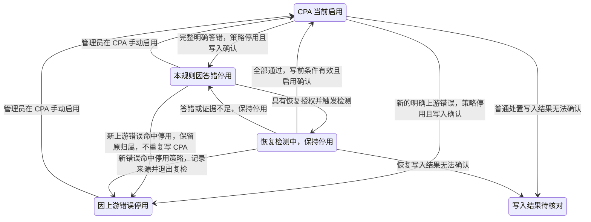

# 质量运维逻辑、产品决策与验收说明

更新日期为 2026-11-21。插件 `0.30.11` / UI `13.7.11` 在固定对象与手动测试中复核 CPA 目录的对象来源，并保留当轮历史证据。[版本记录](CHANGELOG_CN.md)

模块、当前实现及官方接口限制见 [质量运维架构说明](QUALITY_OPERATIONS_ARCHITECTURE_CN.md)，实际测试、构建与部署记录见 [0.30.2 三轮审查](COMMERCIAL_AUDIT_0_30_2_CN.md)、[0.30.1 审查](COMMERCIAL_AUDIT_0_30_1_CN.md) 和 [0.30.0 交付记录](QUALITY_OPERATIONS_0_30_0_CN.md)。第 12 节是此前决策的历史澄清记录，不代表修复后的代码仍有其“旧代码”列所列差异。

## 1. 核心原则

质量运维以凭证、供应商路由或明确授权的供应商组为对象。模型答题提供质量结果，上游响应提供凭证错误证据。规则分别决定两类结果的处理方式。

**“答错仅检测”只控制答题结果后的动作。上游错误属于独立的凭证处置策略。** 配置“答错仅检测，上游错误停用”完全成立，不能将其描述为策略矛盾。

普通停用通过 CPA 公开管理能力停止对象的正常业务调用。管理员在 CPA 手动启用后，启用由 CPA 生效，主项目使用不依赖插件确认。插件在正常刷新、提交测试或规则派发时读取 CPA 当前状态，自动更新旧普通停用记录；手动智商测试和规则检测按 CPA 当前状态、规则范围与调度配置执行，无需额外确认或解除步骤。插件保留历史证据，不再用旧普通停用记录阻断当前已启用对象。

质量运维中的“停用对象”“停止规则”“关闭定时”和历史“独立质量暂停”含义不同，不互相替代。

**上游错误停用的排除优先于答题自动恢复。** 一旦任一规则按上游错误策略将对象停用，所有规则都停止该对象的后续答题和恢复复检，直到用户在 CPA 手动启用。用户启用后，旧普通停用不能继续阻断使用；下一轮按每条规则当时的对象类型、检测范围、启停与调度配置重新选择。

**答错恢复标记跟随同一个 CPA 条目。** 不以整份凭证或配置的内容摘要、token、更新时间或文件修改时间作为标记有效性的依据。同一条目换账号内容或供应商密钥也保留原标记；当前调用与写入使用该轮实际内容，不复用旧回答。

**上游错误不建立答错恢复标记。** 只保留必要的停用来源和错误证据，以区分人工停用和上游错误停用。该来源供所有规则判断退出检测，不能授权答题恢复；CPA 当前已启用时，旧来源不再阻拦使用。

## 2. 对象与状态词汇

| 名称 | 含义 | 边界 |
| --- | --- | --- |
| OAuth 账户 | 规则中的文件凭证对象类别 | 当前实现兼容支持的 CPA 文件凭证，不只限于插件登录创建的账户 |
| AI 提供商 | 根据 CPA 配置与运行时核实的提供商路由或配置组 | 同一服务的登录凭证与 API 密钥可分别纳入 |
| 模型 | 该对象本轮要检测的调用目标 | 模型结果不等于存在独立模型启停权限 |
| 当前启用 | CPA 当前没有将该对象停用 | 不保证本次调用成功，也不等于不存在冷却或其他限制 |
| 普通停用 | CPA 文件凭证 disabled、提供商路由排除或配置组停用 | 可由管理员或规则触发；实际来源需结合记录核实 |
| 答错停用 | 完整可判定的答题结果触发普通停用 | 可在授权下恢复复检 |
| 答错恢复标记 | 关联 CPA 条目与原答错处置规则的恢复归属 | 不绑定全量内容摘要；条目内容更新不使其失效 |
| 上游错误停用 | 已确认的凭证错误触发普通停用 | 仍处于该次停用时退出答题及自动恢复复检 |
| 上游错误停用来源 | 表明当前普通停用来自上游错误的必要记录 | 仅用于原因追溯和退出检测，不是答错恢复标记 |
| 管理员手动启用 | 管理员通过 CPA 启用对象，启用由 CPA 生效 | 插件随正常状态读取更新普通记录，无额外启用审批，不抹掉历史证据 |
| 独立质量暂停 | 历史版本独立保存的暂停归属 | 保留原保护；普通启用不能静默解除 |
| 处置待核对 | 操作是否成功、对象身份或归属无法确认 | 不重放不确定写入，不推定已恢复 |
| 规则停止 | 用户停止整条检测规则 | 对象重新启用不能自动启动管理员停止的规则 |
| 定时关闭 | 不再按 Cron 自动派发 | 符合规则运行条件时仍可由“立即执行”发起 |

当前源码里的 `ManualDisabled` 主要表示 CPA disabled 投影，字段名本身不证明是管理员停用。界面需结合处置记录描述原因。

## 3. 一条规则包含什么

| 配置组 | 配置与含义 |
| --- | --- |
| 检测对象 | OAuth 账户、AI 提供商，允许同时选择 |
| 检测范围 | 仅已启用、全部对象、指定对象 |
| 精确绑定 | 指定凭证、路由或配置组；整组写入授权另行确认 |
| 答题计划 | 模型列表、题目、每模型样本数、请求参数、判题方式 |
| 答错处理 | 仅检测、停用对象、允许范围内删除文件凭证 |
| 上游错误处理 | 分别设置未授权、付款要求、账户额度耗尽、模型不支持的动作 |
| 恢复设置 | 只有答错动作选择停用时可开启自动恢复；恢复与普通检测共用规则周期，分支与记录分别展示 |
| 运行设置 | 规则启停、定时授权、Cron；手动立即执行是规则执行入口 |
| 历史设置 | 每对象保留结果数量或沿用的历史保留方式 |

选择 AI 提供商、选择全部对象、选择一条密钥路由，都不会自动授予整组启停权限。当前 UI 新建默认 OAuth、仅已启用、答错仅检测；支持管理处置时，上游四类错误预选停用。两类策略默认值互相独立。

规则保存和预览不调用模型。旧规则更新时保留已有明确配置和原授权范围，不因改名或迁移自动扩大权限。

规则保存的定时许可与当前定时是否生效分别展示。规则暂停或全局调度关闭时，仍能显式撤销本规则保存的定时许可；之后恢复规则、重开全局调度或重启均不重新授权。编辑器未改动定时开关时保留原状态，不因保存其他字段而启动检测。

规则在停机前已开启且仍具定时许可时，后台启动后自动处理逾期。多个错过的 Cron 周期合并补一轮，读取当前对象及范围、按照当前规则版本重新取证，然后回到原计划。依赖 CPA 管理接口的检测等待后台就绪。普通 OAuth 原生观察可独立继续，混合范围内先执行的对象会留下持久回执，待补时不会重复提交。已开始的旧模型调用、旧样本及待核对写入沿用各自历史记录。

## 4. 两条独立策略

### 4.1 答题质量路径

一轮计划按对象包含全部所选模型与每模型样本。每个计划位置必须恰好具有一份有效、完整、明确判定的结果。

重复 JSON 字段、流终止后继续出现完成事件、同一流切换响应模型或 ID、完成状态中仍带截断原因，都使答案证据无效。工具调用和非预期 choice 不能作为普通答案；正常响应中的 null 工具字段按未使用处理。不能通过解析器覆盖字段或忽略终止边界取得答错或恢复权限。

| 本轮结果 | 答错仅检测 | 答错停用或删除 | 已停用且具有恢复权限 |
| --- | --- | --- | --- |
| 全部明确正确 | 保存结果 | 保持启用 | 满足身份、配置与写前条件后恢复 |
| 全部可判定且至少一个明确错误 | 保存答错 | 按配置处理 | 保持停用 |
| 含未知、拒答、截断、取消、缺失或网络失败 | 保存实际结果 | 不根据答错策略处理 | 不恢复 |

例如两模型各两次，共四份主测样本。三对一错属于完整且有错；两对一错一超时属于证据不足。上游错误策略仍独立检查本轮错误证据。

当前普通停用路径依据一轮完整结果，不采用历史独立暂停的默认三轮失败阈值。人工补充评审不触发自动处置。

内置逻辑题和可复现随机题提供冻结答案。当前确定性判题要求符合严格答案格式，例如只输出一个整数。自定义及视觉题不能因填写了评审说明就自动取得同等的判题证明。

用户已确认：自定义、视觉和人工评审题型也可以独立配置上游错误处理，不需要标准答案。答错自动处置仍必须具有完整、明确的判题证据；人工补充评审不因本次放开而成为自动处置依据。具体题型和参数仍须有实际支持的探测通道，不能承诺尚未实现的协议能力。

### 4.2 上游错误路径

上游错误是凭证可用性处置证据，样本质量判定仍为未知。它不累计答错，也不受“答错仅检测”开关限制。

| 错误类别 | 可确认的依据 | 不能直接替代该依据的情况 |
| --- | --- | --- |
| 未授权 | 实际上游返回 HTTP 401 | 插件连接 CPA 的管理认证失败 |
| 需要付款 | 实际上游返回 HTTP 402 | 文本中偶然出现类似字样 |
| 账户额度耗尽 | 上游 429 及明确的账户额度证据 | 普通速率限制、单模型限额、短时冷却 |
| 模型不支持 | 上游明确的 400/404 及对应模型证据，或已核实的 CPA 模型目录缺少所选模型 | 泛化的 400/404、目录读取失败、空目录或尚未核实的目录 |

上游错误正文和响应头须支持同一结论。429 同时带有请求数或 token 时间窗耗尽证据时只记录 HTTP 错误。400/404 明确点名模型时按本轮实际请求的模型 ID 核对，大小写有别。文件凭证还须取得结构有效的 CPA 管理回执。具体口径见 [上游错误处理](QUALITY_UPSTREAM_ERRORS_CN.md)。

每类错误各自配置动作。“仅记录”不因该策略改变对象状态；“停用”在确认成功后作用于整个凭证或授权供应商组。删除只适用于当前支持删除的文件凭证。

错误证据不要求答题整轮完成。满足错误处置条件后，可以结束受影响对象的剩余模型和样本，其他对象继续执行。

用户明确保留当前目录缺项语义：规则选 A、B，已核实且非空的目录只有 B 时，按缺少 A 形成该对象的目录检查结果，并应用“模型不支持”策略。本轮不再检测 B，也不试图绕过目录定向调用 A。策略为仅记录时保存缺项结果，策略为停用时按授权处理整个对象。这不是一轮答题正确或错误证据，不触发答错处理或恢复。当前停用供应商的配置映射缺项可能先被归为无法定向探测；不能把这个实现限制伪装成已取得可处置的模型错误证据。

### 4.3 合法组合

| 答错处理 | 上游错误处理 | 行为 |
| --- | --- | --- |
| 仅检测 | 停用 | 答错只记录，明确的上游错误可停用 |
| 停用 | 仅记录 | 完整答错结果可停用，上游错误本身只记录 |
| 停用 | 停用 | 两条路径根据各自的新证据处理 |
| 仅检测 | 仅记录 | 两条路径均只记录 |

## 5. 检测范围、探测与恢复权限

范围决定候选对象。对象是否能执行、用哪条通道执行、是否允许写入和恢复，需要继续判断。为支持恢复而探测停用对象时，不临时启用它。

| CPA 当前状态及处置来源 | 仅已启用 | 全部对象 | 恢复或后续处理 |
| --- | --- | --- | --- |
| 已启用，身份可核实 | 纳入普通检测 | 纳入普通检测 | 根据本轮两条策略处理 |
| 管理员手动停用，无其他处置归属 | 不纳入普通检测 | 纳入定向检测，无法探测则记录原因 | 只有明确恢复授权且完整通过才启用 |
| 本规则因答错停用，自动恢复开启 | 纳入恢复复检 | 纳入恢复复检 | 完整通过并核对快照后恢复 |
| 本规则因答错停用，自动恢复关闭 | 不获得“仅已启用”的恢复例外 | 继续检测并记录 | 保持停用，不自动恢复 |
| 其他规则因答错停用 | 不获得本规则的恢复例外 | 可以检测并记录 | 恢复权限仍只属于原停用规则，不能接管归属 |
| 已确认的上游错误停用，CPA 仍停用 | 退出答题检测 | 退出答题检测 | 不进入答题自动恢复；可以读取状态识别管理员启用 |
| 原普通停用对象已被管理员在 CPA 启用 | 根据正常读取的 CPA 当前状态纳入 | 根据正常读取的 CPA 当前状态纳入 | 自动结束旧普通阻断，无额外确认；新一轮可根据新证据再次处置 |
| 历史独立质量暂停、未知写入、身份冲突 | 保留保护 | 保留保护 | 显示对应原因，不自动解除 |

“指定对象”还需满足具体绑定与对象类型。指定整组需要成员身份可核实，整组写入需单独授权，不因范围变化绕过保护。

“全部对象”下管理员手动停用、自己或其他规则因答错停用的对象，都可以在具备通道与身份条件时检测。探测不隐式授予恢复权限。仅已启用范围中的停用对象例外，仍限定为本规则持有且开启恢复的答错停用对象。

自动恢复继续与答错动作 `disable_credential` 绑定。答错仅检测或删除凭证时不提供自动恢复。选择全部、答错仅检测的规则可以检测停用对象并记录，但不会因其通过而启用。

其他规则 B 的只读检测不改变原规则 A 的恢复归属，不授予 B 删除或接管该对象的权限。用户已确认，B 获得新的明确上游错误且将该错误配置为停用时，可以更新对象的错误原因，使所有复检退出，包括 A 的恢复分支。对象在 CPA 已停用，不重复写入停用；保留 A 的原归属和 B 的触发证据。

这里“只读”指探测过程中不写 CPA 对象状态。检测结果和上述已经授权的本地错误原因转换仍需持久记录。条目与本轮实际对象无法唯一对应、当前状态已经变化、旧写入仍待核对时，不能据此转换。已存在的 A 规则答错恢复标记可保留作原归属记录，但上游错误来源存在期间不授予任何规则恢复权限，也不为 B 新建答错恢复标记。

## 6. 停用、恢复与人工启用的状态流转

### 6.1 已确认目标

图中只展示普通停用的主要路径。上游错误停用不会通过“答对后恢复”路径自行转为启用；待核对状态也没有自动重放箭头。管理员手动停用的对象在“全部对象”且有恢复权限时，可使用相同的完整恢复核对流程。

从答错停用转为上游错误停用时，新证据可以由原规则 A 的检测取得，也可以由已获准只读检测的 B 规则取得。记录必须区分原停用规则、原动作与本次触发规则、运行、模型、错误和时间。B 的新发现可以停止恢复，不能转移原归属；B 的错误策略为仅记录时，也不能改变 A 的恢复资格。

### 6.2 管理员启用之后

1. 管理员通过 CPA 启用对象，启用由 CPA 处理，主项目无需等待插件读取状态或清理记录。
2. 插件在页面正常刷新、提交手动测试、规则派发和必要的执行复查中读取当前对象状态。这是正常状态同步，不增加单独的“待插件核实”阶段。
3. 读到同一对象当前已启用后，自动结束旧已确认普通停用的阻断与恢复归属，保留旧错误、样本、动作结果及审计。
4. 手动智商测试根据本次请求读取的当前可用条件执行，无需等待后台轮询或额外核实任务完成。
5. 仍在启用且具备有效定时授权的规则，在下一次匹配轮次读取当前状态，并按该轮当前的对象类型和检测范围重新选择。不会固定回到原停用规则或沿用停用时的旧范围；正常调度周期不属于等待插件批准。
6. 不额外向 CPA 发送一次启用写入，不为了确认启用调用模型，不要求人工核对、删除规则、重新建规则或重启插件。
7. 旧任务、旧计数和旧证据不能再次触发处置。新一轮明确证据可以按原规则再次停用。

合法的供应商 `registered` 状态应和后端、目录及实际能力一致解释，不能仅因不叫 `active` 就拒绝。当前启用也不能覆盖其他仍真实存在的独立限制。

若正常状态读取失败，应报告当前连接、目录或身份无法读取的实际问题，不能仅凭历史停用记录声称 CPA 仍停用。普通对象标识校验和写入前保护继续保留，不构成另一套人工启用许可。

### 6.3 规则生命周期

普通对象停用后，停止受影响的当前任务、跳过后续不具资格的对象即可，不能永久关闭其他直接依赖规则或改写用户的定时设置。

管理员主动停止的规则保持停止。对象恢复不会自动启动它。关闭定时、停止规则、停止某个运行和停用对象分别展示、分别执行。

旧版本自动关闭规则的迁移必须能够区分插件行为与后续管理员操作。证据不足时不批量启用，列出需要处理的规则和原因。

删除凭证与普通停用不同：删除后不能通过自动恢复重建凭证。保留现有删除安全边界，不把“停用后的恢复”扩展成“删除后的重建”。

### 6.4 答错恢复标记、上游错误来源与本轮快照

| 数据 | 用途 | 是否跟随普通内容变化失效 |
| --- | --- | --- |
| 稳定 CPA 条目标识 | 找到同一个被管理条目或授权组 | 不因 token 刷新、更新时间、计数或启停字段改变而变化；同条目换账号或密钥仍保持 |
| 答错恢复标记 | 记录原答错处置规则、动作及恢复归属 | 不因整份内容改变失效，不将该条目误归为无来源的人工停用 |
| 上游错误停用来源 | 保存错误停用事实、原因与触发证据，用于所有规则退出检测 | 不建立答错恢复标记，不授予恢复权限；读到 CPA 当前已启用后结束其阻断作用 |
| 本轮计划和快照 | 证明本轮实际检测对象，以及写入前所依据的当前内容和配置 | 仅影响当前计划、样本或写入是否仍有效，不等于对象被永久换成另一个 |
| 历史快照 | 解释当时配置与证据 | 可留作审计，不能单凭其摘要变化认定用户已启用或对象已更换 |

本轮执行和写回仍需避免作用于错误对象或覆盖新的配置。这里保留的是本轮检查，不把停用时的整份历史数据作为长期标记的身份。用户已经确认，同一条目的 token 正常刷新后，原答错恢复归属保留，使用本轮新快照重新检测；完整通过且写前条件仍有效时才恢复，不再要求与停用时的整份旧快照相同。

用户还明确选择按 CPA 条目延续标记：文件条目换成另一个账号，或供应商同一路由换成另一把密钥，只要仍是同一个条目，就保留答错恢复归属。新一轮使用当前账号、密钥、模型映射与配置完成检测；替换发生在一轮中途时，本轮旧样本不能用于恢复替换后的内容，应使本轮处置失效，再按当前状态重新检测。

稳定标识的字段选择由实现根据 CPA 实际能力决定，不要求使用 MD5 或其他全量内容摘要。OAuth 与供应商可能使用不同条目定位方式。不能把“同条目内容更新”与“删除旧条目并创建新条目”混为一谈，也不能仅凭同名或相同列表位置就证明条目连续。技术上无法唯一对应时保留原记录，明确说明关联问题；旧记录不能成为阻止另一个当前已启用对象正常使用的依据。

### 6.5 答错停用条目在两次读取之间先启用再停用

用户此次担心的是正常答错之后的恢复标记，不是上游错误停用。条目先启用再停用，而插件两次读取都看到停用时，不能因为完整快照或时间戳发生变化就让答错恢复标记失效。按同一个 CPA 条目保留原规则归属，依据当前停用状态、范围和恢复配置处理。

如果插件已经在正常请求中读到启用，旧答错恢复归属结束，旧上游错误来源也不再阻断。此后用户又手动停用，按新的当前人工停用状态处理：仅已启用范围排除，全部范围按其检测和恢复配置处理，不重新激活旧错误来源的阻断作用。

稳定条目标识解决对象关联，不能还原未观察到的启停操作。更新时间或摘要变化也可能来自正常刷新，不能替代启用事实。已核对的 CPA 公开回调主要提供当前状态，没有可据此重建每次人工启停的操作序列；不会增加额外确认按钮，也不以高频轮询承诺必然捕获每次切换。上游错误来源遵循“当前已启用时自动结束阻断”的已确认要求，不借此新增答错恢复标记。

## 7. AI 提供商与整组处理

管理员已允许插件通过官方认证管理接口读取对应配置，在后端内存使用密钥定向探测。密钥不得进入前端、回答历史、日志或其他检测持久数据。

支持单路由启停时按该路由能力操作；只能整组启停时，规则须明确授权该组。不能把选择一把密钥、选择整个目录或发现同组路由解释为隐式整组授权。

普通答错处置必须具有整组完整、同一计划的可判定结果。恢复必须整组每条路由、每个所选模型、每个样本全部正确。缺项、未知、本轮期间的成员变化或影响请求的配置变化，都不能形成整组恢复。轮次间同条目换密钥不清除答错恢复标记，使用当前成员和本轮新快照重新构造完整计划；成员增删或改组仍需核实授权，不能由条目标记隐式扩大到其他组。

已授权整组中的一条路由出现明确上游错误，可以按凭证错误策略提前处理整组。已停用组中新增或替换的路由，需要重新核实成员与身份，不能靠新 ID 绕过未解决组记录。

固定单路由并另行授权整组时，组内其他成员只在原绑定仍能核实该组时采样。已经取得的答题、上游错误或目录缺项证据，写入前同样要复核原路由和当前成员。直接绑定配置组的规则按成员当前所在组判断。

管理员手动启用整组后，应一致核对并更新相关普通处置投影，避免只结束一条路由的记录，而其他旧组记录继续阻止全部路由。

当前不支持供应商配置删除。定向探测不支持的参数、协议或模型映射应报告具体未执行原因，不能作为答错或凭证错误证据。

## 8. 智商测试与质量运维的关联

| 入口 | 模型调用 | 是否执行规则策略 |
| --- | --- | --- |
| 手动智商测试 | 绑定当前核实的对象与模型，通常走 CPA 原生调用 | 不自动停用、恢复或删除 |
| 规则“立即执行” | 执行该规则本轮计划 | 执行该规则答错与上游错误策略 |
| 规则定时检测 | 到期后动态匹配并执行计划 | 执行同一套规则策略 |
| 恢复复检 | 停用中定向检测 | 只在授权及完整条件下恢复；新上游错误独立处理 |
| 打开页面、保存、预览、状态核对 | 不应产生模型调用 | 不应写 CPA 启停 |

手动测试的题面、样本、参数、对象和身份在提交时冻结。重复提交通过回执定位原任务，不应重复消耗调用。用户查看历史与当前进行中的任务需要分别跟踪。

UI 13.7.4 保留手动测试的账户与供应商单条路由分组选择器，思考强度按用户反馈恢复原有下拉框。手动入口仍只绑定一个对象，默认不附加思考参数；请求档位按路由能力展示，能力未知时明确说明，不代表真实上游已经支持或实际采用该档位。此界面整合不改变规则范围、组授权或处置权限，详见 [0.30.3 修复记录](MANUAL_PROVIDER_REASONING_0_30_3_CN.md)。

界面答案匹配、人工评审与自动质量判定当前使用不同字段。产品展示应明确来源，不把人工评审自动转成规则处置依据。

## 9. 执行、调度与界面要求

每轮重新发现符合类型与范围的对象。新增或重新启用的对象在下一轮纳入，不改变已经冻结的当前批次。

对象启用是候选判断的一部分，调用失败正是检测可能发现的结果。不能先要求历史上已证明调用成功才允许质量运维检测。实际能否发出本轮请求，仍由当前身份、协议、接口与运行条件核实。

调度在后端运行，关闭页面不停止已有授权的定时任务。规则、对象、批次和样本的状态分别记录。队列、预算、目录读取或能力限制导致未执行时，不能显示为已完成答题。

用户已确认恢复复检沿用同一规则的 Cron 或“立即执行”。独立是指准入分支、权限、结果和记录独立展示，不新增恢复周期、开关或后台定时器。规则定时关闭时，不因自动恢复已开启而继续后台复检。

界面同时显示当前 CPA 状态与历史处置原因。对象选择、范围预览、手动测试、规则立即执行、定时派发与执行前检查使用一致语义。刷新失败显示数据未核实，不把旧启用状态当作新确认。

建议主要用语：检测对象、检测范围、答错后的处理、上游错误处理、停用对象、恢复复检、停止规则、处置待核对、独立质量暂停。保留“答错仅检测”的准确含义，不把它解释为整条规则完全不会写入。

## 10. 历史、权限和操作保护

普通停用历史与当前阻断分离。已确认管理员启用后，旧记录仍可说明当时发生过什么，但不能继续作为永久检测黑名单。

每条运行记录保存本轮对象与结果。同一路由的答题和另一次目录检查可以各占一行，后者注明未请求上游。旧样本标为完成，同时又保存了执行错误或上游错误条件时，列表、答卷与样本证据均显示执行失败，答案无法判定。只有整轮带错误时，正常样本保留各自的判定，整轮评分省略。详情导出保留原始字段。

写入意图先持久化，结果不能确认时保留待核对。重试、定时与重启不重放未知结果。检测停止或规则修改后的旧证据不得提交新动作。

恢复不临时启用被测对象。文件凭证与配置在写前、写后核对，组授权与成员一致性保留。文件状态接口没有原子条件写入，不能宣称完全消除外部并发操作的窗口。

清理检测历史不改变 CPA 对象状态和规则调度。删除规则不替用户启用对象，不抹去未确认写入和历史独立暂停的必要保护。当前仍有效的上游错误停用来源及必要证据也会保留，删除原规则或触发规则不能重新授权检测或恢复。普通答错记录结束后，新的明确授权仍须通过当前范围和身份校验。

## 11. 已确认决策记录

| 编号 | 已确认要求 | 来源 |
| --- | --- | --- |
| D01 | 每条规则支持 OAuth、AI 提供商及两者同时选择 | 用户最初需求与后续说明 |
| D02 | 全部对象纳入管理员手动停用对象 | 用户范围说明 |
| D03 | 全部范围内 OAuth 与 AI 提供商都可按规则授权自动恢复 | 用户对恢复范围问题的明确答复 |
| D04 | 仅已启用范围保留本规则答错停用且获授权的恢复复检 | 用户明确答复，供应商同样适用 |
| D05 | 上游错误停用覆盖整个凭证或授权组，所有规则的答题和恢复均退出；答对恢复配置不能覆盖，直到用户在 CPA 手动启用 | 用户明确选择凭证级处理及最新补充 |
| D06 | 允许配置绑定的供应商定向探测，密钥仅在后端内存使用 | 用户明确答复 |
| D07 | 允许明确选择并授权整组；全部路由通过才恢复 | 用户明确答复 |
| D08 | CPA 手动启用由 CPA 生效；插件通过正常状态读取自动同步，智商测试与符合条件的定时检测正常使用，无额外确认阶段 | 用户最新要求及本次对“经核实”措辞的澄清，优先于永久排除旧行为 |
| D09 | 手动启用后允许原规则再次停用，只使用新一轮证据 | 用户明确答复 |
| D10 | 答错仅检测与上游凭证错误处理互相独立 | 用户最近明确纠正 |
| D11 | 保留历史独立质量暂停及未知写入保护 | 当前工作区约束，与本次普通停用修复边界一致 |
| D12 | 已核实目录缺项继续按模型不支持策略处理整个对象，本轮不检测其余模型 | 本次 Q1 明确答复，选择沿用当前行为 |
| D13 | 全部范围、本规则答错停用、恢复关闭时仍检测并记录，保持停用 | 本次 Q2 明确答复 |
| D14 | B 规则的全部范围可以检测 A 因答错停用的对象，恢复权限仍只属于 A | 本次 Q3 明确答复 |
| D15 | 恢复复检与普通检测共用规则周期，分支和记录独立 | 本次 Q4 明确答复 |
| D16 | 自动恢复继续要求答错动作选择停用对象 | 本次 Q5 明确答复 |
| D17 | 上游错误处理可用于没有标准答案的题型，答错自动处置仍要求完整明确证据 | 本次 Q6 明确答复 |
| D18 | B 的只读检测发现新上游错误且配置停用时，停止所有复检，保留 A 归属及 B 触发记录，不重复写 CPA | 本次 Q7 明确答复 |
| D19 | 答错恢复标记关联稳定 CPA 条目，不以整份内容摘要、token 或时间戳作为有效性依据；本轮快照与长期标记分开 | 用户最新要求及对“标记”含义的纠正 |
| D20 | 同一个 CPA 条目换账号内容或供应商密钥，也继续沿用答错恢复标记 | Q9 明确选择条目连续性 |
| D21 | 正常 token 刷新后，保留原答错恢复归属，使用本轮新快照检测并核对恢复 | Q10 明确答复 |
| D22 | 上游错误不建立答错恢复标记，只保留用于退出检测的停用来源；CPA 启用后旧来源不再阻拦 | Q11 明确答复 |

## 12. 澄清记录

Q1–Q7 均已经用户在本次对话明确选择，不再作为待定事项。实现需要分别检查哪些是沿用、哪些是行为变更。

| 编号 | 问题 | 修复前代码 | 用户确认 |
| --- | --- | --- | --- |
| Q1 | 选择 A、B，已核实目录缺少 A 时怎么办 | 整个对象走目录检查，可按模型不支持处理，通常不再测 B | 沿用当前：目录缺项也按模型不支持策略处理整个对象 |
| Q2 | 全部范围、本规则答错停用、恢复关闭时是否检测 | 当前不通过恢复准入 | 继续检测并记录，保持停用，不自动恢复 |
| Q3 | B 规则的全部范围是否可检测被 A 因答错停用的对象 | 当前通常因其他规则归属跳过 | B 可以检测并记录，但恢复权限仍只属于 A |
| Q4 | 独立恢复流程是否有独立周期 | 使用原规则定时或立即执行中的恢复分支 | 沿用同一规则周期，恢复复检作为独立分支和记录展示 |
| Q5 | 自动恢复是否继续绑定答错停用选项 | `AutoRestore` 要求 `Action=disable_credential` | 保留关联，答错处理选择停用后才提供自动恢复 |
| Q6 | 上游错误处置是否适用于自定义、视觉或人工评审题型 | 只要存在处置就要求确定性判题且无对照 | 允许独立按凭证错误证据处理，答错自动处置仍须完整可判定 |
| Q7 | B 只读检测遇到已配置停用的新上游错误，是否停止 A 的恢复 | 跨规则只读检测此前被挡，缺少该完整流程 | 是，按新错误证据停止所有复检，保留 A 归属和 B 触发记录，不重复写 CPA |

Q3 中的只读权限不取消独立暂停、未知写入、身份与组边界保护。Q5 不改变上游错误停用对象在管理员启用前退出自动恢复的要求。Q6 不自动解锁官方宿主尚不支持的独立对照身份、LLM 判题或协议能力。

后续补充已回答，其中 Q8 的提问对象被用户纠正：

| 编号 | 问题 | 用户答复或澄清 |
| --- | --- | --- |
| Q8 | 最初误问上游错误停用后的间隔内启停 | 用户纠正：讨论的是正常答错恢复标记是否因完整快照改变失效；上游错误不建立这种标记。原问题不再作为二选一待定项 |
| Q9 | 同一个 CPA 条目换成另一个账号或另一把供应商密钥 | 只要 CPA 条目还是同一个，就继续沿用标记，即使账号或密钥已换 |
| Q10 | 同一账号正常刷新 token，原答错停用且开启恢复 | 允许使用本轮新快照继续复检和恢复，保留稳定条目与原规则归属 |
| Q11 | 上游错误是否仍保留区分停用来源的记录 | 允许保留停用来源记录，不建立答错恢复标记；CPA 启用后旧来源不再阻拦使用 |

## 13. 场景验收

以下保留完整验收条件；实际回归映射与验证结果见 [0.30.0 交付记录](QUALITY_OPERATIONS_0_30_0_CN.md)。供应商换密钥导致宿主定位变化，以及未观察到的删除重建，受下述公开接口限制约束，不能声称已支持可靠的自动关联。

| 编号 | 场景 | 应观察到的结果 |
| --- | --- | --- |
| A01 | 答错仅检测、上游 401 停用，模型明确答错 | 保存答错，不因答错写入 CPA |
| A02 | 同一配置实际返回上游 401 | 停用对象，记录凭证错误；质量结果不记答错 |
| A03 | 一个模型触发错误停用 | 整个凭证或授权组退出后续答题，其余对象继续 |
| A04 | 错误停用对象仍在 CPA 停用 | 所有范围都不发起该对象的后续答题或自动恢复 |
| A05 | 错误停用后管理员在 CPA 启用 | 主项目不等待插件；手动测试提交读取当前状态即可按正常条件执行，无需额外核实任务；原启用规则下轮纳入 |
| A06 | 供应商启用后状态为合法 registered | 与后端能力一致，不触发仅接受 active 的误报 |
| A07 | 手动启用后旧任务返回旧错误 | 不依据旧证据再次停用 |
| A08 | 手动启用后新一轮返回明确错误 | 原规则可按新证据再次停用 |
| A09 | 管理员停止规则，再启用对象 | 规则继续保持管理员停止状态 |
| A10 | 一对象答错停用，另有直接依赖规则 | 规则启停及定时选择保持；受影响对象按状态处理 |
| A11 | 全部范围内管理员手动停用、恢复关闭 | 可定向检测，保持停用，无隐式启用 |
| A12 | 全部范围内管理员手动停用、恢复已授权 | 全部样本通过且写前条件有效才恢复 |
| A13 | 仅已启用、最后一个对象被本规则答错停用、恢复开启 | 下次仍能进入授权恢复分支 |
| A14 | 四个样本三对一错 | 仅在完整有效轮次及对应答错策略下处置 |
| A15 | 四个样本两对一错一超时 | 不按答错处置或自动恢复；独立错误策略另判 |
| A16 | 普通 429、管理接口 401、目录读取失败 | 不被当作账户额度耗尽或实际上游未授权 |
| A17 | 已核实的非空目录缺少部分所选模型 | 整对象走目录检查及模型不支持策略，不测其余模型，不算答题整轮通过 |
| A18 | 全部范围，本规则答错停用且恢复关闭 | 继续检测并记录，不自动恢复 |
| A19 | 多规则遇到他规则答错停用对象 | 全部范围 B 可检测，B 无恢复或接管 A 归属的权限 |
| A20 | 恢复调度与答错仅检测组合 | 恢复与原规则同周期；答错仅检测时不能开启自动恢复 |
| A21 | 自定义或视觉题开启上游错误处置 | 支持的探测路径可独立处理明确错误，不要求把回答判为答错 |
| A22 | 整组只有部分路由通过或部分未执行 | 不恢复整组 |
| A23 | 选单路由但未授权整组写入 | 不执行整组启停 |
| A24 | 组成员、文件身份或配置在检测中变化 | 拒绝基于过期计划写入，显示具体原因 |
| A25 | 停用或恢复写入结果不确定、随后重启 | 保留待核对，不重放写入或旧模型调用 |
| A26 | 清理历史或删除规则 | 不改变 CPA 当前启停，不清除未知写入保护 |
| A27 | 手动智商测试答错或答对 | 不产生规则停用、删除或恢复 |
| A28 | 列表、预览、手动执行、定时执行与刷新 | 当前状态与权限语义一致，旧数据不冒充新确认 |
| A29 | B 只读检测 A 答错停用对象，B 命中已配置停用的新上游错误 | 更新错误原因，A 和其他规则停止复检；保留 A 归属、B 触发证据，CPA 停用请求增量为零 |
| A30 | 相同跨规则场景，B 将该错误配置为仅记录 | 保存 B 的错误结果，A 的恢复权限不因此改变 |
| A31 | A29 后管理员手动启用对象 | 正常状态读取自动结束旧普通阻断，无额外确认阶段；保留 A、B 历史关联，新一轮按当前规则执行 |
| A32 | 多条规则都开启答题正确恢复，其中任一规则触发上游错误停用 | 所有规则均退出该对象后续答题和恢复，不因另一条规则允许恢复而继续调用 |
| A33 | 答错停用条目仍停用，token、更新时间或计数发生正常变化 | 答错恢复标记与原规则归属保留，不因整份内容摘要变化失效 |
| A34 | 答错停用条目在两轮之间先启用再停用，插件未观察到启用 | 同条目的答错恢复标记不因快照或时间戳变化失效，按当前状态及规则处理；不猜测未观察到的操作 |
| A35 | 插件正常读取到启用后，用户又手动停用 | 原答错恢复归属已结束，旧错误来源不再阻断；按当前范围处理新的人工停用 |
| A36 | 相同 CPA 条目中的账号或供应商密钥在轮次间被替换 | 答错恢复标记继续关联该条目；新一轮使用当前内容，不复用旧回答 |
| A37 | 同一账号正常刷新 token，答错停用且允许恢复 | 使用本轮新快照完整复检并核对恢复，不要求停用时整份旧快照一致 |
| A38 | 执行中实际对象身份或影响请求的配置改变 | 本轮旧证据不能写回到新对象或新配置；标记与本轮快照分别处理 |
| A39 | 用户启用对象并调整检测范围 | 下一轮按当前范围重新选择，不能固定沿用原停用规则或停用时的范围 |
| A40 | 上游错误首次停用且此前没有答错恢复归属 | 仅建立停用来源及证据记录，不新增答错恢复标记，所有规则退出后续答题 |
| A41 | 上游错误来源仍有效，另一条规则开启答对恢复 | 不执行答题和恢复，不从来源记录推导恢复权限 |
| A42 | 供应商密钥更换使宿主 AuthID 或 auth_index 改变 | 不能直接据此丢失同一 CPA 条目的答错标记；必须核实条目映射，不能仅按列表位置迁移 |
| A43 | 原停用条目换账号内容后由管理员在 CPA 启用 | 按当前条目与实际内容正常使用，旧邮箱、账号摘要和历史快照不能成为额外启用门槛 |

## 14. 阅读顺序与后续维护

产品讨论以本文已确认决策及用户后续答复为准。代码定位与实施评审使用 [架构说明](QUALITY_OPERATIONS_ARCHITECTURE_CN.md)。后续需求变化时，应同步更新决策记录、范围矩阵、场景验收和架构差异状态。

旧的范围、答错、错误和恢复说明包含不同版本的行为，保留用于历史追溯。尤其“错误停用后不再读取状态”“手动启用后仍永久排除”不能继续作为新目标。当前代码尚未修复的部分也不能在文档中提前声称已上线。

本次文档任务不改变规则、对象配置、管理密钥或真实账户状态。后续实现使用隔离假凭证与假上游验证，并按项目已有要求处理构建和部署。

## 14. 0.30.0 的身份能力边界

同一文件条目的 `AuthID`、`auth_index`、文件名和供应商定位未变时，token、账号内容与更新时间变化不结束答错归属。当前轮次重新读取完整快照，执行和写回继续检查本轮内容。正常读取已确认条目消失时保留 `entry_missing` 历史并结束旧恢复权限；同名后来重建不获得旧例外。

CPA 8.0.76 的供应商 AuthID/index 派生自密钥等可编辑字段，配置写入还会移除调用者提交的 `auth_index`，公开 SDK 没有持久条目 UUID 或编辑事件。因此，换密钥导致定位变化时，插件无法可靠区分原条目更新和删除后新建；保持原记录，不根据名称、位置或组摘要猜测恢复继承。当前已启用的新定位仍可正常测试；当前组启用按本次完整成员核对，历史未知写入和独立暂停保护仍有效。定位不变的配置更新可使用本轮新快照完成检测和恢复。

如果删除并重建完全发生在两次读取之间且 CPA 复用了同一定位，公开接口也无法还原这一历史。这个限制与未观察到的先启用再停用一样，不能靠内容摘要、时间戳或高频轮询消除。
