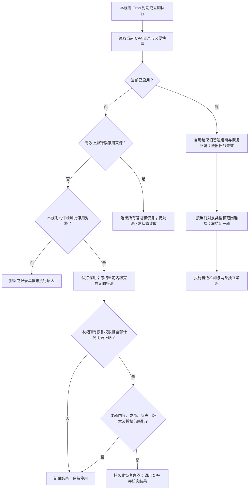

# 质量运维：检测范围与答错恢复

适用源码：插件 **0.30.0**、UI **13.7.0**。恢复只在“答错后的处理”选择普通停用并开启自动恢复时提供，默认关闭；与本规则的 Cron 或“立即执行”共用触发周期，不存在独立恢复定时器。产品依据见 [质量运维逻辑](QUALITY_OPERATIONS_LOGIC_CN.md)。构建与部署状态见 [本轮交付记录](QUALITY_OPERATIONS_0_30_0_CN.md)。

## 范围与权限矩阵

| 当前 CPA 状态和来源 | 仅已启用 | 全部对象 | 恢复资格 |
| --- | --- | --- | --- |
| 已启用 | 普通检测 | 普通检测 | 使用本轮新证据应用规则策略 |
| 管理员停用、无其他处置归属 | 排除 | 可定向检测，能力不足则记录原因 | 全部范围明确开启答错停用及自动恢复时，完整通过后才可恢复 |
| 本规则答错停用、恢复开启 | 恢复复检 | 恢复复检 | 属于原规则，需本轮全部通过及写前检查 |
| 本规则答错停用、恢复关闭 | 无恢复例外 | 检测并记录 | 保持停用 |
| 其他规则答错停用 | 无恢复例外 | 检测并记录 | 不能接管原规则归属、恢复或删除 |
| 上游错误来源仍有效且当前停用 | 排除所有答题 | 排除所有答题 | 所有规则均无自动恢复资格 |
| 历史独立质量暂停或未知写入 | 保留保护 | 保留保护 | 不由普通恢复解除 |

“指定对象”按明确绑定的凭证、路由或授权配置组执行，继续核实类型、身份和权限。普通停用不会永久关闭规则或定时；其他对象继续。用户主动停止的规则保持停止。

## 一轮如何执行

每一阶段继续遵守历史独立暂停、身份冲突、预算、取消和未确认写入保护。普通管理探测不会为测试临时启用对象。明确上游错误可提前触发独立策略，不需等待图中的整轮答案。

## 完整通过与整组恢复

两个模型各两个样本，共四个计划位置：四份明确正确才可恢复；三对一错维持停用；两对一错一超时属于证据不足，也维持停用。超时、网络错误、拒答、截断、取消、缺样本、重复位置或未知答案均不能补齐整轮。

整组启停还须有明确整组授权，并覆盖当前组全部路由、全部模型和样本。部分通过、缺项或本轮成员/配置变化均不能恢复组。供应商密钥只在后端内存用于当前请求。

## 条目归属与当前快照

长期答错恢复归属和本轮内容检查分别保存。同一可核实 CPA 条目在轮次间刷新 token、替换账号内容或更新不改变条目标识的提供商配置，归属继续属于原规则。新的恢复轮次使用当前内容快照，不要求完整内容等于停用时的快照。原授权模型集合仍须完整，不能通过缩减计划恢复。

本轮期间账号、密钥、成员或影响请求的配置改变时，旧样本不能用于写回。该轮停止处置，保留原归属；后续可按当前内容重新完成一轮。文件时间与配置版本仅作本轮条件检查，不能证明发生过一次人工启用。

若管理员在两次读取之间启用又停用，插件始终只观察到同条目停用，不根据时间戳猜测历史；答错标记保留。若正常读取已经观察到启用，旧归属结束，之后新的人工停用按当前范围处理。

公开接口有边界：提供商换密钥可能改变 AuthID/auth_index，缺少持久条目 ID 时不能证明是否为原条目编辑或删除重建；插件不猜测迁移恢复权。已核实完整目录观察到旧定位消失时，将旧记录记为 `entry_missing` 并保留审计，不把旧恢复例外授予随后重建条目。两次读取之间完全不可见的删除重建无法可靠识别。详见 [架构说明](QUALITY_OPERATIONS_ARCHITECTURE_CN.md#95-条目连续性的实现与公开接口限制)。

## CPA 手动启用与跨规则

CPA 手动启用立即由 CPA 生效。正常刷新、提交、派发及执行复查自动同步旧普通记录，不要求核对按钮或确认模型测试。旧任务、旧错误与旧计数不能写回；仍启用且获定时授权的规则下一轮按当前范围选择。

A 答错停用后，B 的全部范围可只读检测。B 新取得明确上游错误并配置停用时，记录 B 的来源，保留 A 归属，不重复写停用，所有规则退出答题和恢复。B 仅记录错误时不改变 A 的恢复资格。此错误来源在 CPA 启用前不能靠删除规则或清理历史消除。

## 写回与验证

文件凭证恢复使用官方管理状态接口。写前保存意图并核对本轮快照，写后确认文件与运行状态；接口没有原子条件状态写入，仍存在外部并发窗口。供应商配置使用 ETag/If-Match；冲突不重试。未知写入不重放，删除凭证不自动重建。

对应回归包括 `TestAnswerOwnershipUsesCurrentEntryContentEachRound`、`TestOwnedRecoveryRejectsMutationInsideRoundButKeepsOwnership`、`TestCrossRuleErrorSourceRetainsAnswerOwnerWithoutRepeatedCPAWrite`、`TestProviderRecoveryUsesNewCompleteGroupSnapshot`、`TestProviderGroupExternalEnableReconciliationIsAtomic`、`TestExternalEnableCancelsStaleRecoveryWithoutChangingRulePermissions`。源码、隔离集成及浏览器的实际验证结果统一记录于本轮交付报告。
